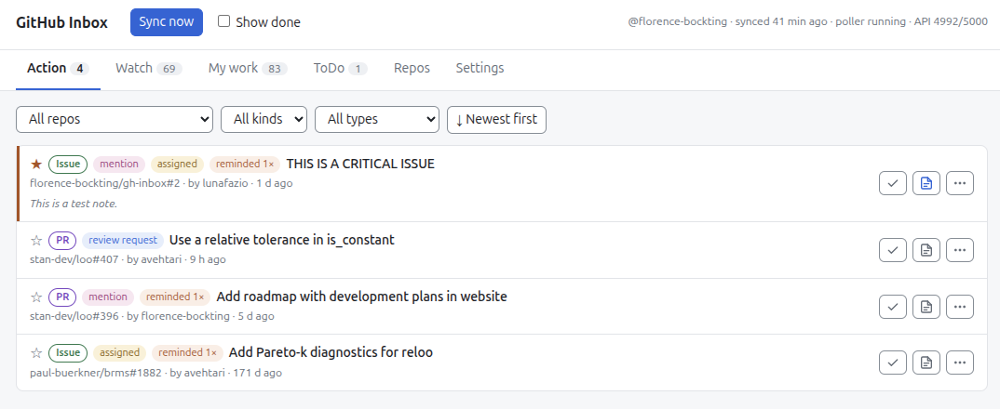
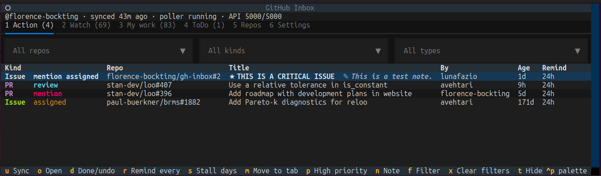

# oss-inbox

!!! note
    This app is a prototype in a test phase. Feedback is welcome: please
    [open an issue](https://codeberg.org/florence-bockting/oss-inbox/issues).

A local inbox for your GitHub and Codeberg notifications. It separates the items that need
your action from the items that you only want to follow. It reminds you again
when you do not act.

The app uses the [`gh` CLI](https://cli.github.com/) for each GitHub request. It
uses no AI service and no extra token. It sends only read requests, so it never
changes anything on GitHub. All data stays on your computer.

Use the app in your browser:

<figure markdown>

</figure>

Or use it in your terminal:

<figure markdown>

</figure>

## Where to start

- [Install](install.md) the app and then read [Use the app](usage.md).
- **Know which problems the app solves:** read [Why oss-inbox?](scenarios.md)
- **Change the code:** read [For developers](developers.md).
