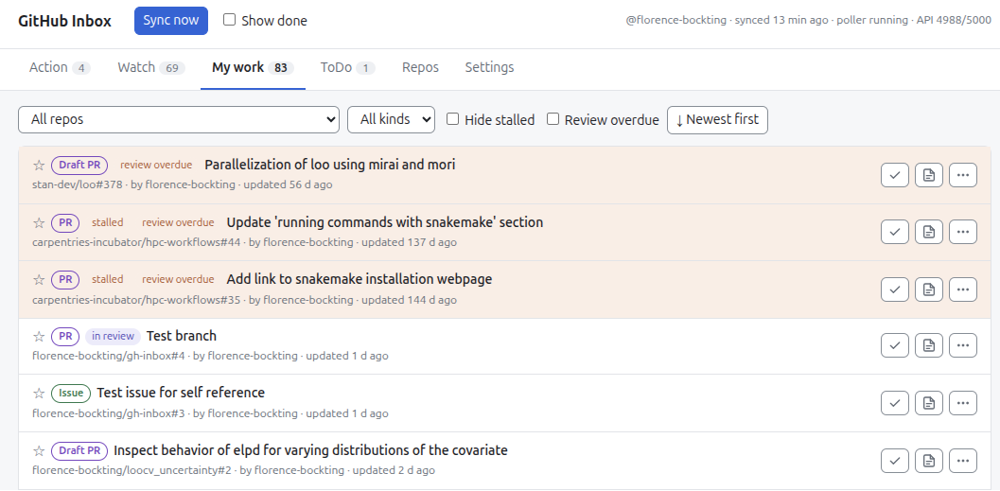
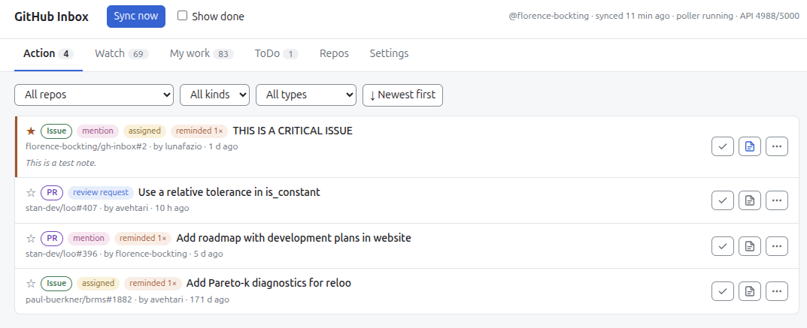
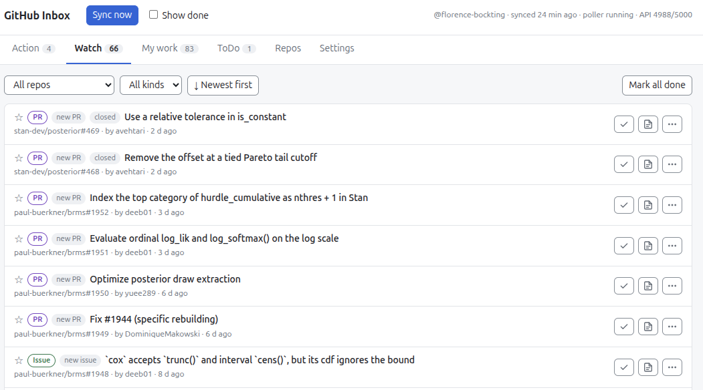
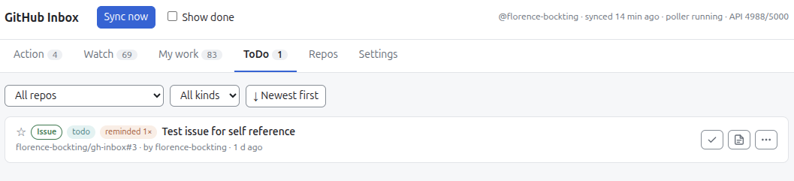
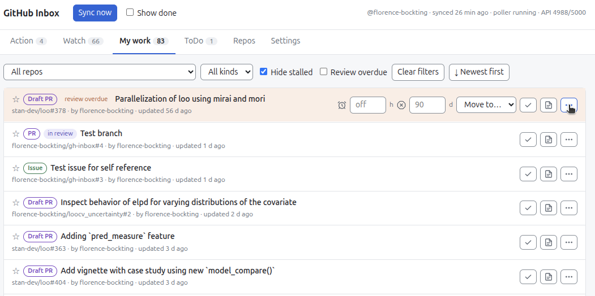
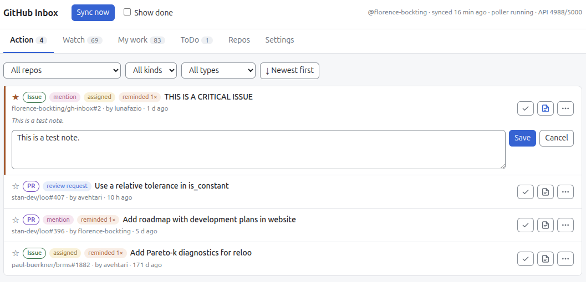

# Why gh-inbox?

Each scenario matches a problem from my old workflow to a solution in the app.
Click a card for the details.

- :material-source-pull:{ .lg } [**All my work in one place**](#my-work)
- :material-bell-alert:{ .lg } [**Never miss a request**](#action)
- :material-eye:{ .lg } [**Follow the community at my own pace**](#watch)
- :material-checkbox-marked-circle-outline:{ .lg } [**Tag myself, never forget**](#todo)
- :material-timer-sand:{ .lg } [**No review gets forgotten**](#review)
- :material-note-edit:{ .lg } [**Private notes on public items**](#notes)

## :material-source-pull: All my work in one place { #my-work .use-case .use-case-1 }

**Problem:** I open issues and pull requests in many repos. I have no single
view of them.

**Solution:** The **My work** tab lists my open items from all repos.

## :material-bell-alert: Never miss a request { #action .use-case .use-case-2 }

**Problem:** GitHub sends me many notifications. Most come from watched repos.
The requests for my action are lost among them. To find these requests again is
difficult.

**Solution:** The **Action** tab lists only the items that need my action:

- Someone mentions me. I probably must join a discussion.
- Someone assigns an issue or a pull request to me.
- Someone requests my review.

## :material-eye: Follow the community at my own pace { #watch .use-case .use-case-3 }

**Problem:** I watch repos to follow the community work. These repos send many
notifications. Most are not urgent for me. I do not want to see them all the
time. I read them only at specific times in the week.

**Solution:** The **Watch** tab collects the new issues and pull requests from my
watched repos. I browse them when I have time. No item in this tab needs my
action.

## :material-checkbox-marked-circle-outline: Tag myself, never forget { #todo .use-case .use-case-4 }

**Problem:** In a pull request, I find a follow-up task. I write it as a to-do
item. I do not open the follow-up pull request yet. Later, someone merges the
pull request. I then forget the to-do.

**Solution:** I tag myself with my login, for example `@florence-bockting`, in the to-do item. The **ToDo** tab
collects all items with a self-mention. The item stays there after a merge. I
use GitHub for my own task management.

## :material-timer-sand: No review gets forgotten { #review .use-case .use-case-5 }

**Problem:** I work on several pull requests. Some wait for a review. While I
wait, I work on other things. I forget the waiting pull requests. The reviewer
can also forget them. Then nothing happens.

**Solution:** The **My work** tab reminds me after N days without a review. The
pull request shows "review overdue". A pop-up comes. I can then tag the reviewer
again.

## :material-note-edit: Private notes on public items { #notes .use-case .use-case-6 }

**Problem:** I want to add internal information to an item, for example a
blocker. This information does not belong in a GitHub comment. GitHub has no
private note on an item.

**Solution:** I attach a note to an item in any tab. The app saves each note in
one row of a CSV file. The row has the URL of the item. I can share the file
with others.

