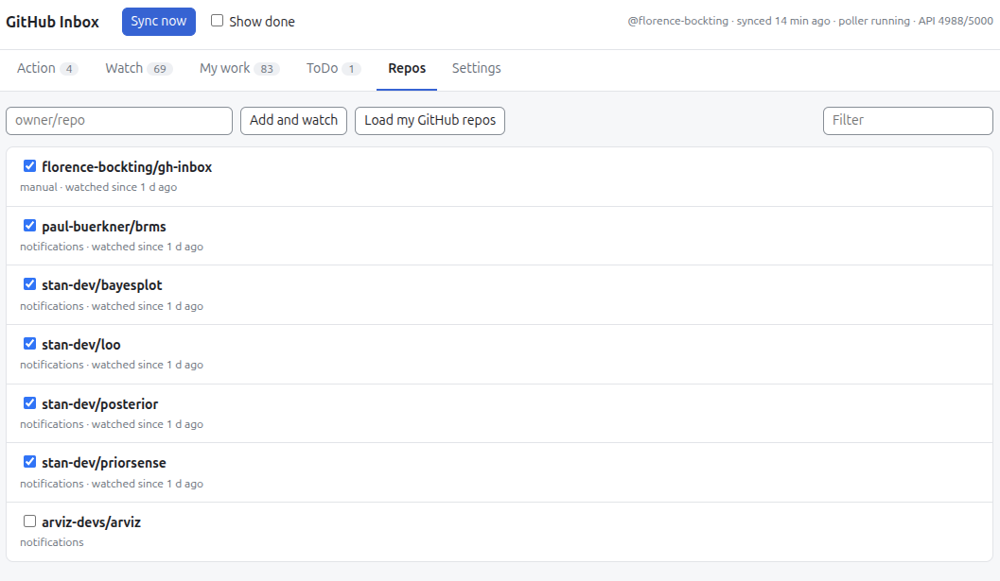
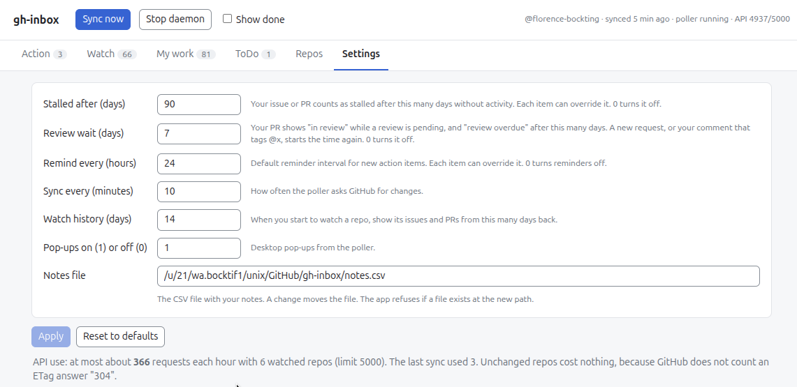

# Use the app

You can use oss-inbox in two ways:

- In your browser, on a local web page.
- In your terminal, with a text interface.

!!! note "The command name"
    This page writes `oss-inbox`. You get this command when you
    [install from the source](install.md#install-from-the-source).
    If you use the [executable](install.md#download-the-executable), type the file name
    instead. Run the command in the folder that contains the file.

    | System | Command | Example |
    | :-- | :-- | :-- |
    | Linux | `./oss-inbox-linux` | `./oss-inbox-linux stop` |
    | macOS | `./oss-inbox-macos` | `./oss-inbox-macos stop` |
    | Windows | `.\oss-inbox-win.exe` | `.\oss-inbox-win.exe stop` |

## Start the app

=== "In the browser"

    To open the web page, run this command in a terminal. On Windows, use PowerShell.

    ```bash
    oss-inbox web
    ```

    The command opens http://127.0.0.1:8765 in your browser.

    <figure markdown>
    
    </figure>

    Each item has these buttons in the web page.

    | Icon | Meaning |
    | :-- | :-- |
    | ☆ / ★ | Give the item high priority, or remove it |
    | { height="16" } | Mark the item done |
    | { height="16" } | Undo done |
    | { height="16" } | Add or edit a note. The icon is blue when the item has a note. |
    | { height="16" } | Show more options: reminder, stall time and **Move to…** |
    | { height="16" } | Remind me every N hours (behind { height="16" }) |
    | { height="16" } | Stalled after N days, in My work (behind { height="16" }) |

=== "In the terminal"

    To open the terminal UI, run this command in a terminal. On Windows, use PowerShell.

    ```bash
    oss-inbox tui
    ```

    <figure markdown>
    
    </figure>

    Keys in the terminal UI:

    | Key | Action |
    | :-- | :-- |
    | `1`–`6` | Go to a tab |
    | `o` or `Enter` | Open the item in the browser |
    | `d` | Done, or undo |
    | `n` | Write or change the note of the item |
    | `r` | Set the reminder interval of the item |
    | `s` | Set the stall time of the item (My work) |
    | `m` | Move the item to another tab |
    | `p` | Give the item high priority, or remove it |
    | `f` / `x` | Go to the filters / clear the filters |
    | `t` | Hide stalled items (My work) |
    | `w` | Show only the PRs with an overdue review (My work) |
    | `h` | Show done items |
    | `v` | Reverse the order: newest first or oldest first |
    | `A` | Mark all Watch items done |
    | `Space` | Watch a repo, or stop (Repos) |
    | `a` / `L` | Add a repo / load your GitHub repos (Repos) |
    | `e` | Edit a setting (Settings) |
    | `u` | Sync now |
    | `q` | Quit |

## First steps

Do steps 1 to 3 once, after the first start. Then the inbox fills up. Do step 4 when you want to stop the app.

1. **Select the repos to watch.** Open the **Repos** tab.

    === "In the browser"

        Click **Load my GitHub repos**. Or type `owner/repo` and click
        **Add and watch**. Then select the check box of each repo to watch.

    === "In the terminal"

        Press `L` to load your GitHub repos. Or press `a` to add a repo. Then
        press `Space` on each repo to watch.

    <figure markdown>
    
    </figure>

2. **Check the settings.** Open the **Settings** tab. Keep the
   [default settings](#default-settings), or change them.

    === "In the browser"

        Type a new value in a field. Then click **Apply**. The app saves no
        change before you click **Apply**.

        **Reset to defaults** fills in the default values. Click **Apply** to
        save them.

    === "In the terminal"

        Press `e` on a setting to edit it.

    <figure markdown>
    
    </figure>

3. **Sync.** Click **Sync now**, or press `u` in the terminal. Wait for the
   items to appear in the tabs.

4. **Stop the daemon.** The daemon keeps running when you close the terminal or the
   web page. It then still syncs and sends pop-ups. Stop the daemon with:

    === "In the browser"

        Click **Stop daemon**.

    === "In the terminal"

        Run `oss-inbox stop`.

## Basic commands

The background process (the "daemon") syncs with GitHub every 60 minutes
([default settings](#default-settings)). It
sends the pop-ups and serves the web page.

The daemon runs in the background. You can close the terminal after `oss-inbox web`.
To stop the daemon, click **Stop daemon** on the web page, or run `oss-inbox stop`.
The web page then shows "The daemon stopped" within 5 seconds.
When the daemon runs again, the open page reloads.

Run these commands in a terminal on Linux and macOS, or in PowerShell on Windows.
To get the `oss-inbox` command, see [Install](install.md).

| Command | What it does |
| :-- | :-- |
| `oss-inbox daemon` | Starts the background process. Only one can run. |
| `oss-inbox web` | Opens the web page. Starts the daemon in the background if it does not run. |
| `oss-inbox stop` | Stops the daemon |
| `oss-inbox tui` | Opens the terminal UI |
| `oss-inbox sync` | Runs one sync now |
| `oss-inbox test-popup` | Sends 2 test pop-ups |

## How your inbox is organized

### Overview of the tabs

An item is one issue or PR in a tab.

| Tab | Content |
| :-- | :-- |
| **Action** | Review requests, @mentions and assignments in the repos that you watch |
| **Watch** | New issues and PRs, and all other notifications, in the repos that you watch. No action is necessary. |
| **My work** | Your open issues and PRs in all repos. An item is "stalled" when it has no activity for N days. A PR shows "in review" while a review is pending, and "review overdue" after N days. See [Default settings](#default-settings) for N. |
| **ToDo** | Your own tasks: issues and PRs where you [mention yourself](#get-reminders), in the repos that you watch. You can also [move any item](#move-an-item-to-another-tab) here. |
| **Repos** | The repos that you watch in this app |
| **Settings** | Stall time, review wait, reminder interval, sync interval, pop-ups and the notes file. See [Default settings](#default-settings). |

Each item has a **PR**, **Issue** or **Draft PR** label. In Action, an item
can have a **mention** tag and an **assigned** tag at the same time. The two tags
have different colors.

You can **filter** Action, Watch, My work and ToDo by repo and kind. You can also
filter Action by type. In My work, you can also hide the stalled items, or show
only the PRs with an overdue review.

Items are **ordered** by default according to recency with the most recent item
coming first. This order can be changed from "Newest first" to "Oldest first".
Exceptions are [stalled](#track-stalled-items) and [prioritized](#set-the-priority) items.

### How the item status updates

The app finds out when you act on an item:

- **Review request:** GitHub removes the request when you submit a review. The
  item then goes to "done".
- **Mention:** the item goes to "done" when you reply after the last mention.
  A new mention opens the item again. While you are an assignee, the item
  stays open.
- **To-do:** your later replies do not mark the to-do done. A close or a merge
  also does not mark it done. Click { height="16" }. A
  newer self-mention opens it again.
- **Assignment:** the item goes to "done" when the issue closes, or when you are
  no longer assigned. A new assignment opens a done item again.

You can also click { height="16" } ("Done") yourself,
which changes only the appearance in the app. GitHub still shows the
notification as unread.

### When pop-ups show up

A pop-up appears when...

- ... a **new item** appears in *Action* or *ToDo*.
- ... an item gets [stalled](#track-stalled-items) i.e., no action
  has been done on the item within a specific time period ({ height="16" }).
  The pop-up comes again after a reminder interval ({ height="16" }).
- ... a **PR review** that <u>you requested</u> is overdue. The pop-up comes again after the
  reminder interval ({ height="16" }). To start
  the wait time again, request the review again, or tag @x in a comment.

A pop-up comes again after the [reminder interval](#default-settings)
until you act. You can set an interval for each item ({ height="16" }). 0 turns the reminders off.

The title of a pop-up starts with an emoji. The emoji shows the type:

| Emoji | Pop-up |
| :-- | :-- |
| 🔍 | Review requested |
| 💬 | You were mentioned |
| 👥 | Your team was mentioned |
| 📌 | You were assigned |
| 🔔 | Other action item |
| ✅ | Your to-do |
| ⏳ | Review overdue |
| 💤 | Stalled |
| 📬 | Summary of more than 5 pop-ups |
| ⚠️ | Few GitHub API requests left |

More than 5 pop-ups at the same time become one summary pop-up.
The app sends the pop-ups 2 seconds apart. Some desktops do not show pop-ups that come faster.

### Default settings

The app comes with certain default settings in the **Settings** tab which you
can change any time.

| Setting | Default |
| :-- | :-- |
| Stalled after (days) | 30 |
| Review wait (days) | 3 |
| Remind every (hours) | 24 |
| Sync every (minutes) | 60 |
| Watch history (days) | 14 |
| Pop-ups on (1) / off (0) | 1 |
| Notes file | `~/oss-inbox/notes.csv` |

## Work with items

### Set the priority

- Click ☆ on an item, or press `p` in the terminal UI to prioritize an item.
  High-priority items come first in the list.
- Click ★, or press `p` again, to remove the high priority.

### Move an item to another tab

- Click { height="16" } on an item. Then use **Move to…**. In the
  terminal UI, press `m`. The item goes to
  Action, Watch, My work or ToDo.
- The [pop-ups](#when-pop-ups-show-up) follow the tab that shows the item. A moved item gives stalled
  pop-ups only when it is your own item in My work.

### Add a note to an item

- Click { height="16" } on an item, or press `n` in the terminal UI. Write the note.
  In the web page, Ctrl+Enter saves it. An empty note deletes it.
- A note belongs to the issue or PR. It shows in every tab with that item.
- The app saves the notes in a CSV file. The default is `~/oss-inbox/notes.csv`
  ([default settings](#default-settings)).
  You can edit the file by hand. The app reads it again at each page load.
- When you change the "Notes file" setting, the app moves the file. If a file
  exists at the new path, the app refuses.
- The terminal UI shows and edits only the first line of a note. Edit notes
  with more than one line in the web page.

### Get reminders

Mention yourself in an issue or PR on GitHub. Use your own GitHub login, for
example "@your-login open a follow-up PR". The item goes to ToDo, not to Action.
You get a pop-up. The pop-up comes again after the [reminder interval](#default-settings) until you act.
See also [When pop-ups show up](#when-pop-ups-show-up).

To mark the to-do done, see [How the item status updates](#how-the-item-status-updates).

### Track stalled items

An item in My work is "stalled" when it has no activity for [30 days](#default-settings).
This applies to your own open issues and PRs.

- A stalled item gives one [pop-up](#when-pop-ups-show-up).
- To change the 30 days for all items, change "Stalled after (days)".
  See [Default settings](#default-settings).
- To change the days for one item, click { height="16" }, then { height="16" }. In the
  terminal UI, press `s`. 0 turns it off for the item.
- To hide the stalled items, use the filter in My work. In the terminal UI,
  press `t`.
- A stalled item appears first in the list of the My work tab.

## GitHub API use

The app only reads from GitHub. It never writes to GitHub.

GitHub limits the API requests for each account, usually to 5000 each hour.
The app shares this limit with `gh` and other tools that use your login.
A repo with no changes costs no request, because GitHub does not count the
answer "304 Not Modified".

- Below 20% of the limit, the app warns you. The status bar shows the number
  in color, the web page shows a banner, and one pop-up comes.
- Below 10% of the limit, the sync pauses. It starts again when GitHub resets
  the limit. The status bar shows the time.

The **Settings** tab shows the most requests that the app can use in one hour
with your watched repos. It also shows the cost of the last sync.

To use fewer requests, watch fewer repos, or increase "Sync every (minutes)".
See [Default settings](#default-settings).

The status bar is at the top of the web page and of the terminal UI. It shows:

| Part | Meaning |
| :-- | :-- |
| `@your-login` | The GitHub account that `gh` uses |
| `synced 5m ago` | The time of the last sync. Before the first sync: `never synced`. |
| `poller running` | The daemon syncs with GitHub. In red: `poller not running`. Run `oss-inbox web` to start the daemon again. |
| `sync error` | The last sync failed. In the web page, move the mouse on it to see the error. |
| `API 4800/5000` | GitHub API requests left in this hour, and the limit. See [GitHub API use](#github-api-use). |

The terminal UI also shows `showing done` when it shows done items.

## Privacy

- The web page listens only on `127.0.0.1`. Other computers cannot open it.
- The data is in `~/.local/share/oss-inbox/`. Remove this folder to remove all
  data. Your notes are in a different place: the "Notes file" setting
  ([add a note to an item](#add-a-note-to-an-item)).
- The app does not send your notes to GitHub.
- The pop-ups show issue titles. Other people can see them on your screen.
